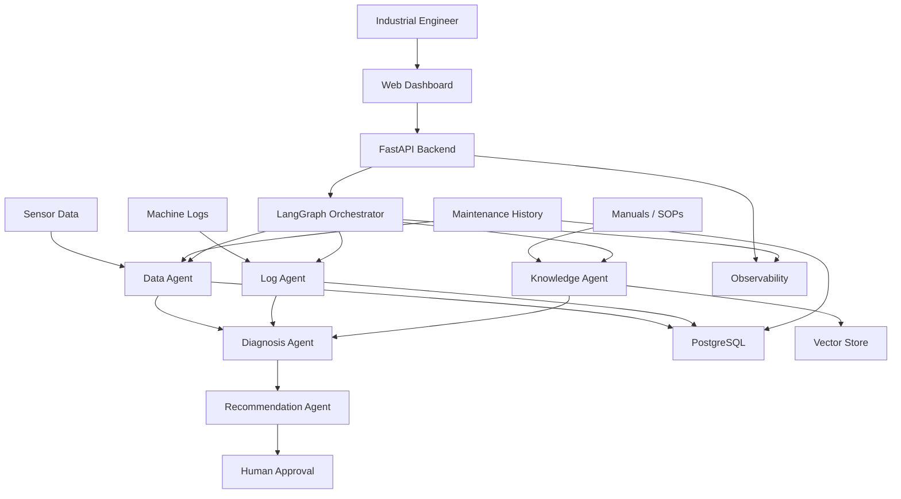
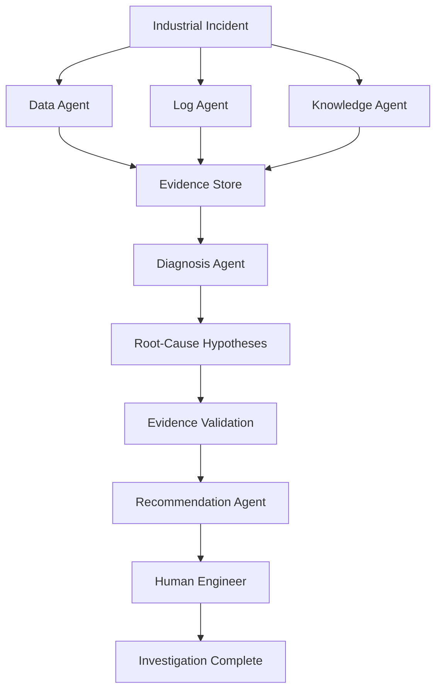

# Industrial Incident Investigator

> **Evidence-based AI for industrial incident investigation, root-cause analysis, and maintenance decision support.**

Industrial Incident Investigator (I²) is an AI-powered platform designed to help industrial engineers investigate machine and production incidents by combining sensor data, machine logs, maintenance history, and technical documentation.

The system transforms heterogeneous industrial data into structured evidence, root-cause hypotheses, and actionable recommendations while keeping a human engineer in the loop.

---

## 🚧 Project Status

**Research & Development — MVP**

The first version is focused on offline investigation using synthetic and uploaded industrial data.

Real-time industrial integrations, digital twins, reinforcement learning, and robotics are planned for later phases.

---

# 1. Problem

When an industrial machine unexpectedly stops or behaves abnormally, engineers may need to investigate information distributed across:

* Sensor data
* Machine logs
* Maintenance history
* Work orders
* Technical manuals
* Standard operating procedures
* Previous incidents
* Operator notes

The investigation can therefore require significant manual effort.

The core question addressed by I² is:

> **How can an industrial engineer move from raw operational data to an evidence-based explanation and actionable next steps faster and more reliably?**

---

# 2. Solution

I² creates an AI-assisted industrial investigation workflow.

```text
                    INDUSTRIAL INCIDENT
                            │
             ┌──────────────┼──────────────┐
             │              │              │
             ▼              ▼              ▼
        Sensor Data     Machine Logs    Documents
             │              │              │
             ▼              ▼              ▼
        Data Agent      Log Agent     Knowledge Agent
             │              │              │
             └──────────────┼──────────────┘
                            ▼
                    Evidence Collection
                            │
                            ▼
                    Diagnosis Agent
                            │
                            ▼
                  Root-Cause Hypotheses
                            │
                            ▼
                  Recommendation Agent
                            │
                            ▼
                     Human Engineer
                            │
                     ┌──────┴──────┐
                     ▼             ▼
                  Approve      Modify/Reject
```

The platform is designed as an intelligence layer above existing industrial systems rather than a replacement for ERP, MES, SCADA, CMMS, or historian platforms.

---

# 3. Main Use Case

### Example

Machine `M17` unexpectedly stops at `14:32`.

The engineer provides:

```text
machine_data.csv
machine_logs.txt
maintenance_history.csv
machine_manual.pdf
```

The system investigates the incident.

Expected result:

```text
INCIDENT
Machine: M17
Time: 14:32

LIKELY ROOT CAUSE
Pneumatic pressure instability

CONFIDENCE
78%

EVIDENCE
✓ Pressure dropped before shutdown
✓ Valve response became abnormal
✓ Similar incidents occurred previously
✓ Technical documentation supports the hypothesis

RECOMMENDED CHECKS

1. Inspect pressure regulator
2. Inspect pneumatic valve
3. Check air filter

HUMAN REVIEW

[ APPROVE ] [ MODIFY ] [ REJECT ]
```

---

# 4. Product Principles

## Evidence before explanation

The system should collect and structure evidence before generating conclusions.

## Explainability

Important conclusions must be connected to evidence.

## Uncertainty

The system must be able to say:

> **Insufficient evidence.**

It should not generate an unsupported confident diagnosis.

## Human-in-the-loop

The MVP recommends actions but does not autonomously control industrial equipment.

## Progressive integration

The first MVP works with uploaded files.

Later versions can connect to industrial systems.

---

# 5. System Architecture



---

# 6. Multi-Agent Workflow



---

# 7. Agents

## Data Agent

Responsibilities:

* Load sensor datasets
* Validate schemas
* Clean data
* Calculate statistics
* Detect anomalies
* Identify abnormal time windows
* Produce structured evidence

---

## Log Agent

Responsibilities:

* Parse machine logs
* Normalize timestamps
* Classify events
* Build incident timelines
* Detect event sequences
* Identify events preceding failures

---

## Knowledge Agent

Responsibilities:

* Load technical documents
* Parse PDFs
* Chunk documents
* Generate embeddings
* Retrieve relevant passages
* Provide document evidence

Potential sources:

```text
Technical manuals
Maintenance procedures
SOPs
Previous incident reports
Work instructions
Operator notes
```

---

## Diagnosis Agent

Responsibilities:

* Combine evidence
* Generate root-cause hypotheses
* Compare competing hypotheses
* Identify supporting evidence
* Identify missing evidence
* Estimate confidence
* Detect insufficient evidence

---

## Recommendation Agent

Responsibilities:

* Generate recommended diagnostic checks
* Prioritize actions
* Explain why each action is recommended
* Link recommendations to evidence
* Request human approval

The MVP does not autonomously execute industrial actions.

---

# 8. Technology Stack

## Backend

* Python
* FastAPI
* Pydantic
* SQLAlchemy

## AI / Agents

* LangGraph
* LangChain components where useful
* LLM provider abstraction
* Structured outputs

## Data Science

* NumPy
* Pandas
* scikit-learn
* Time-series analysis

## RAG

* PDF/document parsing
* Embeddings
* Vector database
* Retrieval evaluation

## Database

* PostgreSQL

## Frontend

* React
* TypeScript

## Infrastructure

* Docker
* Docker Compose

## Observability

* OpenTelemetry
* Logs
* Traces
* Metrics

---

# 9. Repository Structure

```text
industrial-incident-investigator/
│
├── README.md
├── LICENSE
├── CONTRIBUTING.md
├── SECURITY.md
├── CHANGELOG.md
├── .gitignore
├── .env.example
├── docker-compose.yml
├── Makefile
├── pyproject.toml
│
├── docs/
│   ├── product.md
│   ├── requirements.md
│   ├── architecture.md
│   ├── use-cases.md
│   ├── data-contracts.md
│   ├── agent-design.md
│   ├── evaluation.md
│   ├── security.md
│   ├── deployment.md
│   │
│   ├── diagrams/
│   │   ├── system-architecture.mmd
│   │   ├── agent-workflow.mmd
│   │   ├── incident-flow.mmd
│   │   └── deployment.mmd
│   │
│   └── decisions/
│       ├── ADR-001-stack.md
│       ├── ADR-002-agent-architecture.md
│       └── ADR-003-vector-store.md
│
├── backend/
│   ├── app/
│   │   ├── main.py
│   │   ├── api/
│   │   ├── core/
│   │   ├── models/
│   │   ├── schemas/
│   │   └── services/
│   └── tests/
│
├── agents/
│   ├── state.py
│   ├── graph.py
│   ├── data_agent/
│   ├── log_agent/
│   ├── knowledge_agent/
│   ├── diagnosis_agent/
│   └── recommendation_agent/
│
├── ml/
│   ├── preprocessing/
│   ├── anomaly_detection/
│   ├── feature_engineering/
│   ├── models/
│   └── evaluation/
│
├── rag/
│   ├── ingestion/
│   ├── chunking/
│   ├── embeddings/
│   ├── retrieval/
│   └── evaluation/
│
├── data/
│   ├── raw/
│   ├── processed/
│   ├── synthetic/
│   └── README.md
│
├── evaluation/
│   ├── datasets/
│   ├── benchmarks/
│   ├── metrics/
│   └── reports/
│
├── frontend/
│   ├── components/
│   ├── pages/
│   ├── services/
│   └── types/
│
├── infra/
│   ├── docker/
│   ├── postgres/
│   ├── observability/
│   └── deployment/
│
├── scripts/
│   ├── generate_dataset.py
│   ├── ingest_documents.py
│   ├── run_evaluation.py
│   └── seed_database.py
│
└── tests/
    ├── unit/
    ├── integration/
    ├── agents/
    ├── rag/
    └── end_to_end/
```

---

# 10. Development Roadmap

## Phase 0 — Product Definition

* Define users
* Define problem
* Define use cases
* Define input/output contracts
* Define success metrics

---

## Phase 1 — Infrastructure

* Repository
* FastAPI
* PostgreSQL
* Docker
* Configuration
* Logging

---

## Phase 2 — Synthetic Industrial Dataset

Create:

* 20 virtual machines
* Sensor readings
* Machine logs
* Maintenance history
* Known failure modes
* Ground-truth labels

---

## Phase 3 — Data Science Engine

Implement:

* Data preprocessing
* Feature engineering
* Anomaly detection
* Incident-window detection
* ML evaluation

---

## Phase 4 — Evidence Layer

Implement:

* Log parsing
* PDF ingestion
* Chunking
* Embeddings
* Retrieval
* Evidence objects

---

## Phase 5 — Multi-Agent Investigation

Implement:

```text
Data Agent
Log Agent
Knowledge Agent
Diagnosis Agent
Recommendation Agent
```

and orchestrate them with LangGraph.

---

## Phase 6 — Human Review

Implement:

```text
Approve
Modify
Reject
```

and store the decision as an audit event.

---

## Phase 7 — Evaluation

Measure:

* Root-cause accuracy
* Top-3 accuracy
* Evidence precision
* Retrieval quality
* Hallucination rate
* Recommendation acceptance
* Investigation time

---

## Phase 8 — Production Engineering

* Authentication
* Authorization
* Secure file handling
* Observability
* Error handling
* Rate limiting
* Deployment

---

## Phase 9 — Industrial Integration

Future connectors:

```text
OPC-UA
MQTT
SCADA
MES
CMMS
ERP
Historian
REST APIs
```

---

## Phase 10 — Digital Twin

```text
Real Machine
      ↓
Historical Data
      ↓
Digital Model
      ↓
Simulation
```

---

## Phase 11 — Reinforcement Learning

```text
State
 ↓
Policy
 ↓
Action
 ↓
Simulation
 ↓
Reward
 ↓
Policy Update
```

---

## Phase 12 — Physical AI / Robotics

```text
AI
 ↓
Digital Twin
 ↓
Simulation
 ↓
Reinforcement Learning
 ↓
Robot
 ↓
Physical Environment
```

---

# 11. Team Responsibilities

| Area              | Youssra | Ismail          |
| ----------------- | ------- | --------------- |
| Product           | Lead    | Support         |
| Data Science      | Lead    | Support         |
| Synthetic Dataset | Lead    | Support         |
| Anomaly Detection | Lead    | —               |
| RAG               | Lead    | Infrastructure  |
| Agents            | Lead    | Integration     |
| Diagnosis         | Lead    | API Integration |
| Recommendations   | Lead    | UI              |
| FastAPI           | Support | Lead            |
| PostgreSQL        | Support | Lead            |
| Frontend          | —       | Lead            |
| Docker            | Support | Lead            |
| CI/CD             | Support | Lead            |
| Security          | Support | Lead            |
| Evaluation        | Lead    | Support         |
| Deployment        | Support | Lead            |
| Documentation     | Both    | Both            |

---

# 12. Evaluation Dataset

Each incident should have ground truth.

```text
evaluation/datasets/
│
├── incident_001/
│   ├── machine_data.csv
│   ├── machine_logs.txt
│   ├── maintenance_history.csv
│   ├── manual.pdf
│   └── ground_truth.json
│
├── incident_002/
│   └── ...
│
└── incident_020/
    └── ...
```

Example:

```json
{
  "incident_id": "INC-001",
  "machine_id": "M17",
  "true_root_cause": "pressure_regulator_failure",
  "severity": "high"
}
```

---

# 13. Key Metrics

### Root Cause Accuracy

```text
Correct diagnoses / Total incidents
```

### Top-3 Accuracy

Was the correct root cause included among the top three hypotheses?

### Evidence Quality

Are the cited sensor events, logs, and documents relevant?

### Hallucination Rate

How often does the system produce unsupported information?

### Recommendation Acceptance

How often does the engineer accept or modify the recommendation?

### Investigation Time

Compare:

```text
Manual investigation time
vs.
AI-assisted investigation time
```

---

# 14. Security Principles

Industrial data may be highly sensitive.

Therefore:

* Never commit secrets
* Never commit `.env`
* Validate uploaded files
* Limit file size
* Restrict file types
* Protect APIs
* Keep audit logs
* Separate tenants in future versions
* Do not expose industrial data publicly
* Require human approval for operational actions

---

# 15. Git Workflow

We use:

```text
main
  │
  └── develop
        │
        ├── feature/data-agent
        ├── feature/rag-pipeline
        ├── feature/diagnosis-agent
        ├── feature/fastapi-api
        └── feature/frontend-dashboard
```

Feature workflow:

```bash
git checkout develop

git pull origin develop

git checkout -b feature/my-feature

# implement changes

git add .

git commit -m "feat: implement my feature"

git push -u origin feature/my-feature
```

Then open a Pull Request into `develop`.

---

# 16. Definition of Done

A feature is complete when:

```text
✓ Implemented
✓ Tested
✓ Documented
✓ Error handled
✓ Logged when appropriate
✓ Committed
✓ Pull Request reviewed
✓ Merged
```

---

# 17. MVP Definition

The MVP is complete when a user can:

1. Upload machine data.
2. Upload machine logs.
3. Upload maintenance history.
4. Upload technical documentation.
5. Create an investigation.
6. Run the investigation.
7. See detected anomalies.
8. See the incident timeline.
9. See retrieved evidence.
10. See root-cause hypotheses.
11. See confidence.
12. See recommendations.
13. Approve, modify, or reject recommendations.
14. View investigation history.

---

# 18. Long-Term Vision

The long-term platform evolves through:

```text
Incident Investigation
        ↓
Root Cause Analysis
        ↓
Predictive Maintenance
        ↓
Prescriptive Maintenance
        ↓
Simulation
        ↓
Digital Twin
        ↓
Optimization
        ↓
Reinforcement Learning
        ↓
Physical AI
        ↓
Robotics
```

The goal is not to build another generic industrial chatbot.

The goal is to create an **industrial decision-intelligence layer** connecting operational data, technical knowledge, AI reasoning, simulation, optimization, and eventually physical systems.

---

# 19. Team

**AI / Data / Agents**

Youssra

**Backend / Platform / Product Engineering**

Ismail

---

# 20. License

To be decided.
